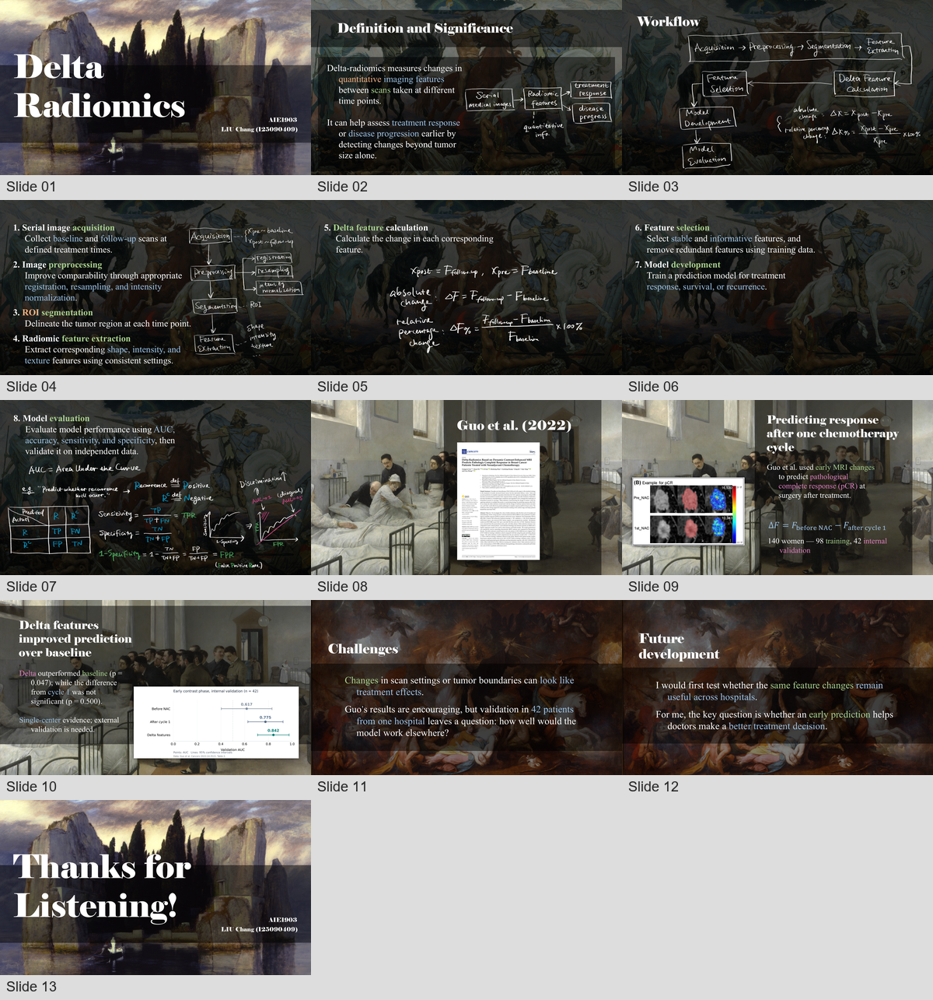

# Kratz PPT Skill

以主题相关的油画或坦培拉、半透明黑色蒙版和衬线排版制作学术演示文稿的个人 Codex 技能。

制作前先收集标题与作者信息，提供至少 **5 幅不同的高清绘画候选**供用户选择；背景下载使用 **Full resolution / Original file**。同页多条内容中，第一条直接显示，后续逐次点击使用 PowerPoint 原生 **Appear（出现）** 动画。



## 视觉规范

| 项目 | 默认规则 |
|---|---|
| 画幅 | 16:9，13⅓ × 7.5 英寸 |
| 背景 | 与章节存在隐喻或联想关系的油画、坦培拉；按章节复用 |
| 标题 | Elephant，普通页 35–40 pt，封面与结尾 100 pt 起步 |
| 正文 | Times New Roman，常规 28 pt；案例 24 pt；讨论 30 pt |
| 公式 | Cambria Math |
| 蒙版 | 无描边黑色矩形；单层 50% 不透明度，双层重叠为 75% |
| 配色 | 白色为主，浅蓝、浅绿强调；少量粉紫与浅橙 |
| 英文段落 | 原生悬挂缩进：左缩进 2 cm，首行偏移 −1.27 cm |
| 学术图像 | 优先真实论文截图，保留坐标、图例、单位和来源 |

这些数值来自一份 13 页参考演示。具体内容、页数、署名和画作按新任务确定。完整说明见[风格规格](references/style-spec.md)、[量化参数](references/style-tokens.json)和[量化报告](references/quantitative-report.md)。

## 安装与调用

将整个仓库作为 `kratz-ppt-skill` 文件夹放入个人技能目录。以下命令使用 `$CODEX_HOME/skills`，未设置时使用 `~/.codex/skills`；目标文件夹应尚不存在。[OpenAI 官方文档中的个人技能目录示例](https://developers.openai.com/cookbook/examples/codex/iterating-development-workflows-with-codex)。

**Windows PowerShell：**

```powershell
$kratzSkillsRoot = if ($env:CODEX_HOME) {
    Join-Path $env:CODEX_HOME "skills"
} else {
    Join-Path $HOME ".codex\skills"
}
New-Item -ItemType Directory -Force -Path $kratzSkillsRoot | Out-Null
git clone https://github.com/stefanokratzdisteln-hash/kratz-ppt-skill.git (Join-Path $kratzSkillsRoot "kratz-ppt-skill")
```

**macOS / Linux：**

```bash
mkdir -p "${CODEX_HOME:-$HOME/.codex}/skills"
git clone https://github.com/stefanokratzdisteln-hash/kratz-ppt-skill.git \
  "${CODEX_HOME:-$HOME/.codex}/skills/kratz-ppt-skill"
```

在加载此技能的 Codex 会话中输入：

```text
请使用 $kratz-ppt-skill，根据我提供的论文制作12页英文汇报。
先给我制作前问题清单，以及至少5幅相关的高清油画或坦培拉背景候选。
我选定背景后，再制作可编辑的PPT，并让后续条目逐次点击出现。
```

本仓库包含风格指令、参考素材和辅助脚本。完整演示文稿由使用此技能的助手结合可用的 PPT 创作工具生成；辅助脚本分别负责找画、下载原图、写入动画和量化审计。

## 制作流程

1. **填写问题清单。** 收集标题、副标题、作者与机构、语言、受众、时长或页数及论文材料；已提供的信息直接复用。
2. **比较至少5幅候选。** 展示不同作品的预览、作者、媒介、主题关系、实际像素、作品页和原图链接。
3. **由用户选图。** 可以选一幅复用，也可以为不同章节选择多幅；选定后正式排版。
4. **保存完整分辨率原图。** 缩略图仅用于候选浏览。原图无法下载时保留链接，让用户手动下载。
5. **制作与核验。** 保留可编辑文字、原生悬挂缩进和独立蒙版；添加逐条 Appear 动画，并检查布局、图表来源与动画序列。

详见[制作前清单](references/preflight-and-background-choice.md)、[素材获取规则](references/art-sourcing.md)和[动画实现与验收](references/appear-animation.md)。

## 辅助脚本

在仓库根目录运行以下命令。需要 Python 3.10+；`apply_appear.py` 还需要 Windows 桌面版 Microsoft PowerPoint。字体文件不随仓库分发，需要在目标环境安装对应字体，或记录实际使用的替代字体。

```bash
python -m pip install -r requirements.txt
```

### 查找绘画候选

```bash
python scripts/find_art_candidates.py --query landscape --query journey \
  --count 8 --download --output-dir art-candidates
```

PowerShell 中可将以上命令写在同一行。搜索词仅为示例，应按汇报主题更换。脚本检索 Met 与 AIC 的公开馆藏，生成 `candidates.json`、候选网页、原始图像与独立预览。

默认用实际宽 ≥1920、高 ≥1080 像素检查全屏背景适用性；这不是下载尺寸上限。脚本只下载来源明确提供的原文件，不以服务缩略图替代。少于5幅已验证高清图时会报告不足；搜索命中还须人工核对主题关系、媒介和构图。

### 下载 Commons 完整分辨率原图

```bash
python scripts/download_full_resolution.py \
  "https://commons.wikimedia.org/wiki/File:Arnold_B%C3%B6cklin_-_Die_Toteninsel_I_(Basel,_Kunstmuseum).jpg" \
  --output-dir selected-art
```

该作品仅为命令示例。脚本从 Commons 文件页解析 `Original file`，保存原始字节并核对来源尺寸；不回退到缩略图。遇到限流或下载失败，会保留作品页和原图直链供手动获取。

### 添加逐条 Appear 动画

为每个逻辑条目建立有唯一名称的文本框或形状，并准备清单：

```json
{
  "version": 1,
  "slides": [
    {
      "slide": 1,
      "items": [
        {"id": "first", "shapes": ["item01_text"]},
        {"id": "second", "shapes": ["item02_text"]},
        {"id": "third", "shapes": ["item03_text", "item03_figure"]}
      ]
    }
  ]
}
```

```bash
python scripts/apply_appear.py draft.pptx items.json animated.pptx --report animation-check.json
```

第一项无入场效果；后续每项消耗一次点击，同项多个形状同步出现，已显示内容保留。脚本写入新的 PPTX，并核验重新打开后的 PowerPoint 动画属性与文件内时间序列。目标页已有动画时会报告冲突，输出文件也必须尚不存在。静态预览不能代替实际放映检查。

### 审计排版参数

```bash
python scripts/audit_pptx.py animated.pptx --output-dir kratz-ppt-audit
```

输出字体、字号、颜色、段落缩进、几何位置和蒙版覆盖等 OOXML 统计。图片内文字不属于可编辑文字统计；字体替代、图中文字可读性和复杂图形需结合渲染检查。

## 仓库结构

```text
kratz-ppt-skill/
├── README.md
├── SKILL.md
├── requirements.txt
├── agents/openai.yaml
├── assets/
│   ├── reference.pptx
│   └── reference-contact-sheet.png
├── references/
│   ├── style-spec.md
│   ├── style-tokens.json
│   ├── preflight-and-background-choice.md
│   ├── art-sourcing.md
│   ├── appear-animation.md
│   └── … 量化报告与样本证据
└── scripts/
    ├── find_art_candidates.py
    ├── download_full_resolution.py
    ├── apply_appear.py
    └── audit_pptx.py
```

画作、论文图和字体的使用条件以各自来源为准。参考演示用于复核视觉系统，其主题、署名和学术内容不自动带入新稿。
